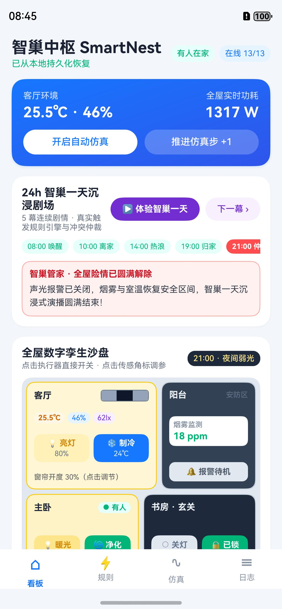
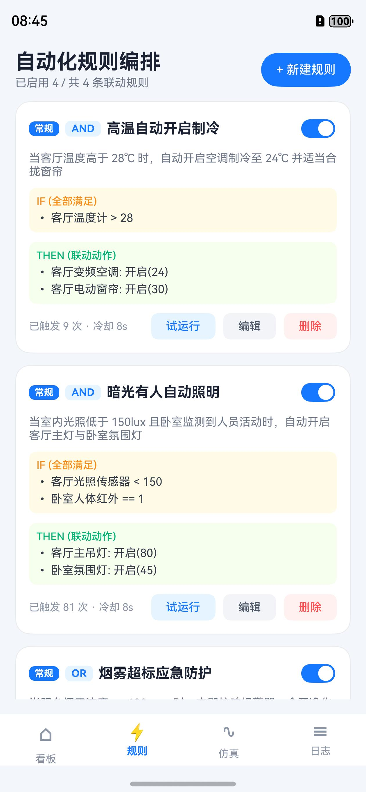
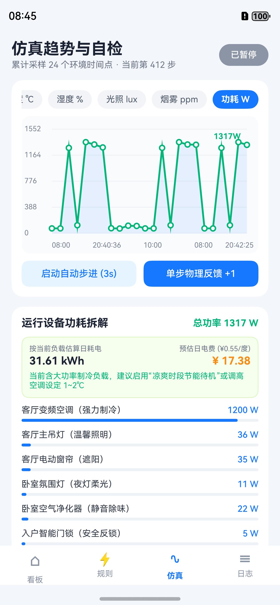
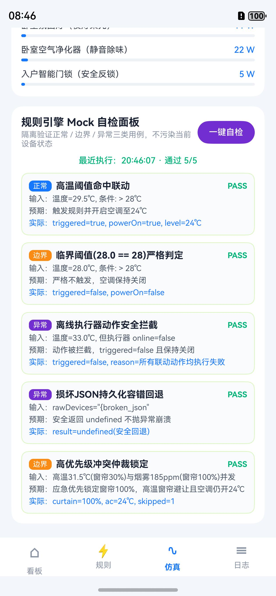

# 智巢中枢（SmartNest）—— 智能家居规则编排与交互仿真系统

> 《移动应用开发基础》期末大作业（主题三：智能场景规则编排与交互仿真系统）  
> 开发者：`SongRan-mk`（独立完成）  
> 仓库地址：`https://github.com/SongRan-mk/smart-nest-harmony`

---

## 1. 项目简介

**智巢中枢（SmartNest）** 是一款基于 **HarmonyOS 5.0.5 (API 17)** 与 **ArkTS / ArkUI** 开发的智能家居中控与自动化规则仿真应用。系统通过面向对象模型抽象多房间传感器与执行器，内置真实的 `IF-THEN` 多条件规则引擎、物理环境反馈仿真器与 `@kit.ArkData` Preferences 持久化能力，支持重启恢复与异常安全拦截。

### 核心特性
- **多房间设备看板与控制**：覆盖客厅、主卧、书房、阳台 4 大区域共 13 台虚拟设备（温度、湿度、光照、人体红外、烟雾传感器 + 空调、灯光、电动窗帘、空气净化器、智能门锁、声光报警器），支持一键情景模式（回家/睡眠/离家布防/解除告警）与突发工况演练。
- **可视化规则编排器**：支持新建、编辑、启停、二次确认删除与试运行自动化规则；支持 `AND / OR` 多条件组合、全部 6 种比较运算符（`>` `>=` `<` `<=` `==` `!=`）、4 级仲裁优先级、防抖冷却时间及表单合法性校验。
- **真实规则引擎与物理仿真**：支持优先级降序调度与同周期执行器冲突仲裁锁定；支持 3 秒自动周期仿真与手动单步推进（响应 Ability 前后台生命周期自动挂起/恢复），模拟昼夜光照、空调降温与空气净化器排烟反馈；基于 `Canvas` 绘制温度/湿度/光照/烟雾/总功耗趋势折线图并估算日耗电量与电费。
- **数据持久化与容错恢复**：接入 `EntryAbility` 上下文与 `Preferences`，所有设备状态、规则修改、历史采样与联动日志均自动落盘并在冷启动后完整恢复；内置离线设备安全拦截与 JSON 损坏回退机制。
- **24h 智巢一天沉浸剧场**：看板内置 5 幕连续剧情演播（`08:00 唤醒` → `10:00 离家` → `14:00 热浪` → `19:00 归家` → `21:00 险情仲裁`）与智巢管家实时解说气泡，全程真实驱动规则引擎与数字孪生沙盘联动。
- **Mock 自检与单元测试**：应用内置一键 5 项三类（正常/边界/异常）Mock 自检台，并在 `entry/src/test` 中提供完整的 Hypium 单元测试套件（13 项核心用例全部通过）。

---

## 2. 开发环境与运行方式

### 开发环境
- **IDE**：DevEco Studio（支持 HarmonyOS 5.0.5 / API 17）
- **Target / Compatible SDK**：`5.0.5(17)`
- **开发语言与框架**：ArkTS + ArkUI + Ability Kit + ArkData + Hypium 测试框架

### 本地运行步骤
1. 克隆仓库并打开工程：
   ```bash
   git clone https://github.com/SongRan-mk/smart-nest-harmony.git
   ```
2. 使用 **DevEco Studio** 打开项目根目录 `smart-nest-harmony`。
3. 等待 Ohpm / Hvigor 同步完成，选择 **HarmonyOS Emulator（模拟器）** 或已连接的真机。
4. 点击右上角 **Run (`entry`)** 启动应用。
5. 运行单元测试：右键 `entry/src/test/RuleEngine.test.ets` 选择 **Run 'RuleEngine.test.ets'** 即可执行全部 11 项核心 Mock 单元测试。

---

## 3. 工程目录结构

```text
entry/src/
├── main/ets/
│   ├── entryability/EntryAbility.ets       # Ability Kit 生命周期与持久化初始化/后台落盘
│   ├── model/
│   │   ├── Types.ets                       # 核心枚举与规则/日志/场景接口
│   │   ├── DeviceModels.ets                # BaseDevice -> SensorDevice / ActuatorDevice OOP 模型
│   │   ├── DefaultDataFactory.ets          # 默认 4 房间、13 设备、4 规则、4 场景工厂
│   │   └── NavTypes.ets                    # Navigation 路由参数定义
│   ├── service/
│   │   ├── RuleEngine.ets                  # 规则校验、AND/OR 条件求值、冷却防抖与动作执行
│   │   ├── SimulationEngine.ets            # 物理环境反馈仿真、功耗计算与趋势采样
│   │   ├── PersistenceService.ets          # ArkData Preferences 读写与损坏回退
│   │   └── SmartHomeStore.ets              # 全局响应式状态协调中心与内置 Mock 自检
│   ├── components/
│   │   ├── DeviceCard.ets                  # 自定义设备卡片组件
│   │   ├── EnvironmentChart.ets            # Canvas 环境趋势折线图组件
│   │   └── HomeFloorPlan.ets               # 全屋数字孪生交互式户型沙盘组件
│   ├── view/
│   │   ├── DashboardView.ets               # 智居看板页
│   │   ├── RulesView.ets                   # 规则编排页
│   │   ├── SimulationView.ets              # 仿真趋势与自检页
│   │   └── LogsView.ets                    # 联动日志与存储管理页
│   └── pages/
│       ├── Index.ets                       # Navigation + Tabs 主框架
│       ├── DeviceDetailPage.ets            # 设备详情、滑块仿真与离线故障切换页
│       └── RuleEditorPage.ets              # 规则新建与编辑页
└── test/
    ├── List.test.ets
    └── RuleEngine.test.ets                 # 正常/边界/异常三类 Hypium 单元测试
```

---

## 4. 运行效果展示

### 4.1 应用主要页面截图

| 智居看板与数字孪生沙盘 | 规则编排与优先级仲裁 | 仿真趋势与能耗拆解 | 内置三类 Mock 自检 | 联动与仲裁日志 |
| :---: | :---: | :---: | :---: | :---: |
|  |  |  |  |  |

### 4.2 实际运行录屏
> 录屏文件建议放置于 `docs/demo/smart-nest-demo.mp4`（或发布至 GitHub Release / README 视频拖拽上传后替换下方链接）：

- [点击查看应用实际运行录屏（需在本地或仓库补充上传后生效）](docs/demo/smart-nest-demo.mp4)

---

## 5. 需求文档
- 详细需求分析、系统架构、数据结构与接口约定见：[软件需求说明书](docs/软件需求说明书.md)
